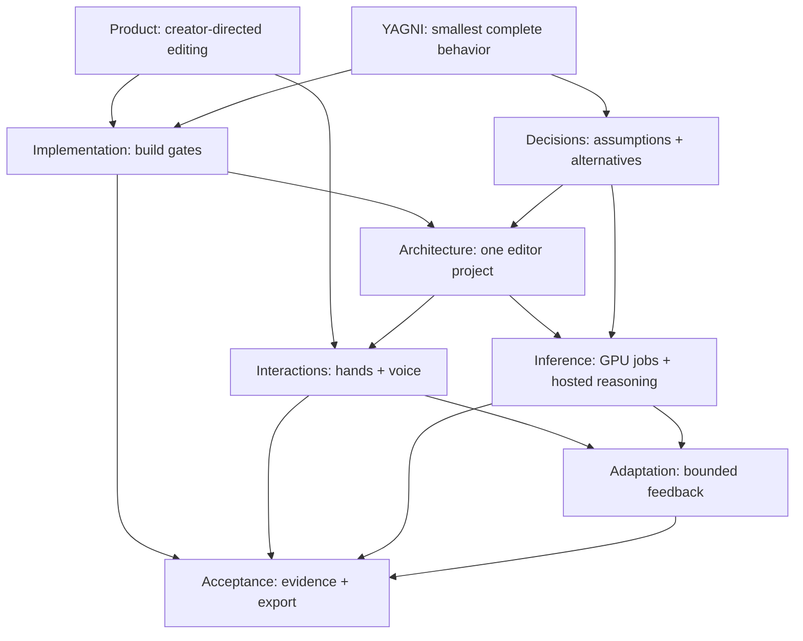

# Shway knowledge graph

Start here. This is a version-controlled wiki in the repository, not a separate GitHub Wiki.
Each page links to related concepts; the map below shows how they connect.

**Status:** implementation plan, October 10, 2026. The fork exists; no successful local build,
gesture implementation, export test, or TRIBE benchmark has been recorded.
Update this statement when there is evidence, with a commit or reproducible result.

## Handoff and HTML plan

- [Implementation handoff](../HANDOFF.md): current state, first-session checklist, decisions, and open questions.
- [HTML implementation plan](../shway-implementation-plan.html): download or open from a checkout in a browser. GitHub displays the source; this file is not a hosted deployment.

## Start a task

1. Read [AGENTS.md](../../AGENTS.md), [CLAUDE.md](../../CLAUDE.md), and [YAGNI](yagni.md).
2. Read [Product](product.md), then the current gate in [Implementation](implementation.md).
3. Follow the relevant graph edges below. Read the actual source and upstream docs before coding.
4. Implement the smallest complete behavior, verify it, and update the affected pages.
   Linear tracks task status; this wiki tracks design, contracts, decisions, and verification evidence.

## Knowledge graph

If your Markdown viewer disables clickable Mermaid nodes, use these ordinary links:

| Page | What it answers |
| --- | --- |
| [Product](product.md) | What are we building and what should the demo feel like? |
| [Implementation](implementation.md) | What comes next, which Linear tickets, and when is it finished? |
| [Architecture](architecture.md) | Where does each component run and what owns the project? |
| [Interactions](interactions.md) | How do twist, swipe, voice, and undo work together? |
| [Inference](inference.md) | How do transcription, the LLM, and TRIBE connect? |
| [Adaptation](adaptation.md) | What learns, what stays stable, and how are patches evaluated? |
| [Acceptance](acceptance.md) | What evidence proves the experience works? |
| [Decisions](decisions.md) | Which choices are settled, provisional, or still unknown? |
| [YAGNI](yagni.md) | How do agents avoid building unnecessary systems? |

## Project references

- [Shway repository](https://github.com/TheRealOP/Shway)
- [Linear project](https://linear.app/dev-system/project/schway-4deadf7f36cc), currently named Schway.
- [Reviewed execution plan](https://linear.app/dev-system/document/shway-product-architecture-and-hackathon-execution-plan-12141d616571)
- [Filmcraft engine architecture](../architecture.md)
- [Upstream contributor documentation](../contributing.md)

Keep pages small and connected. Link to the canonical contract rather than copying it.
